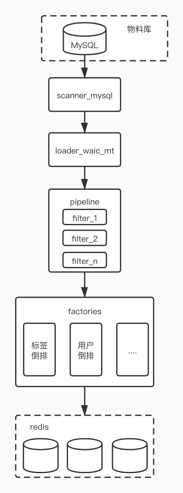

标签倒排的代码。
基于新版物料库。

## 依赖

* 依赖[vcore](https://gitlab.weibo.cn/weibo_video_recom/vcore)项目的代码。

## 部署

* 10.185.17.222 (使用跳板机登录)

```shell
# tab推荐流，推荐召回需要的各种倒排
23-59/30 * * * * /bin/bash /data1/lijiang/tagrecall2/bin/run_tab_rec.sh

# tab推荐流，
10 * * * * /bin/bash /data1/lijiang/tagrecall2/bin/run_tab_pgc.sh
```


## 推荐召回使用倒排

### 机器学习标签的倒排，按热度序。

先使用人工标签，没有再使用机器标签。

```ini
key = newtab_tag_ + TAGID + _v1
num = 300
redis_addr = ["rm51826.eos.grid.sina.com.cn", 51826, 0]

# ruf 监控：
alert_key = newtab_tag_v1_update
alert_data = int(time.time())
```

* demo [http://vrconsole.recom.weibo.com:12888/tag2midlist?tagid=newtab_tag_1042015:moviePerson_264088_v1&host=rm51826.eos.grid.sina.com.cn&port=51826&db=0&fids=10776,10777&num=200](http://vrconsole.recom.weibo.com:12888/tag2midlist?tagid=newtab_tag_1042015:moviePerson_264088_v1&host=rm51826.eos.grid.sina.com.cn&port=51826&db=0&fids=10776,10777&num=200)

### 基于作者UID的倒排，按热度序。

```ini
key = newtab_uid_ + UID + _v1
num = 300
redis_addr = ["rm51826.eos.grid.sina.com.cn", 51826, 0]

# ruf 监控：
alert_key = newtab_uid_v1_update
alert_data = int(time.time())

# return 特征
vert: 是否竖版; value int, eg：{"mid": "4617616649358240", "aid": "5718310125", "score": "0.1215", "vert": 1}
```

* demo [http://vrconsole.recom.weibo.com:12888/tag2midlist?tagid=newtab_uid_6355408342_v1&host=rm51826.eos.grid.sina.com.cn&port=51826&db=0&fids=10776,10777&num=200](http://vrconsole.recom.weibo.com:12888/tag2midlist?tagid=newtab_uid_6355408342_v1&host=rm51826.eos.grid.sina.com.cn&port=51826&db=0&fids=10776,10777&num=200)

### 基于作者UID的倒排，按时间倒排。

``` ini
key = newtab_uid2_ + UID + _v2
num = 300
redis_addr = ["rm51826.eos.grid.sina.com.cn", 51826, 0]

# ruf 监控：
alert_key = newtab_uid2_v2_update
alert_data = int(time.time())

# return 特征
vert: 是否竖版; value int, eg：{"mid": "4617616649358240", "aid": "5718310125", "score": "1618194582", "vert": 1}
```

* demo [http://vrconsole.recom.weibo.com:12888/tag2midlist?tagid=newtab_uid2_6355408342_v2&host=rm51826.eos.grid.sina.com.cn&port=51826&db=0&fids=10776,10777&num=200](http://vrconsole.recom.weibo.com:12888/tag2midlist?tagid=newtab_uid2_6355408342_v2&host=rm51826.eos.grid.sina.com.cn&port=51826&db=0&fids=10776,10777&num=200)

### 投稿标签（统一标签）倒排，按热度序 - 预计 3.29 下线。

投稿标签（统一标签）倒排，按热度序 - 预计 3.29 下线。

```ini
key = newtab_tag2_ + TAGID + _v2
num = 300
redis_addr = ["rm51826.eos.grid.sina.com.cn", 51826, 0]

# ruf 监控：
alert_key = newtab_tag2_v2_update
alert_data = int(time.time())
```

* demo [http://vrconsole.recom.weibo.com:12888/tag2midlist?tagid=newtab_tag2_197468_v2&host=rm51826.eos.grid.sina.com.cn&port=51826&db=0&fids=10776,10777&num=200](http://vrconsole.recom.weibo.com:12888/tag2midlist?tagid=newtab_tag2_197468_v2&host=rm51826.eos.grid.sina.com.cn&port=51826&db=0&fids=10776,10777&num=200)


### 投稿标签倒排，基于官方投稿ID

```ini
key = tab_sid_ + ID + _v3
num = 300
redis_addr = ["rm51826.eos.grid.sina.com.cn", 51826, 10]
```

* demo [http://vrconsole.recom.weibo.com:12888/tag2midlist?tagid=tab_sid_4379155802846569_v3&host=rm51826.eos.grid.sina.com.cn&port=51826&db=10&fids=10776,10777&num=200](http://vrconsole.recom.weibo.com:12888/tag2midlist?tagid=tab_sid_4379155802846569_v3&host=rm51826.eos.grid.sina.com.cn&port=51826&db=10&fids=10776,10777&num=200)


### HS降级物料（单一标签、bigdata L1）：
```ini
# l1 一共 57个
key = newtab_tag2mids_v1
value = {tag_id: [{"mid": mid, "aid": aid, "score": score, "gid": gid}]}
num = 100
redis_addr = ["rm20605.eos.grid.sina.com.cn", 20605, 0, false]
```
* demo: 不支持，自己取redis
```python
import redis
import zlib
import json
r=redis.Redis(host="rm20605.eos.grid.sina.com.cn",port=20605, db=0)
result=json.loads(zlib.decompress(r.get("newtab_tag2mids_v1")))
```

## 运营投递倒排

### pgc流内运营投递倒排

- PGC运营投递物料，一级、二级标签、is_all_1 建立物料倒排，已经在 is_all_1的mid，不出现在l1/l2标签倒排中
- 线上总控匹配，采用热门实时画像(分数截断L1 sc>=0.2, L2 sc>=0.1 ） 
  - 21177 热门微博热门流一级短期兴趣小时级(增量)-新体系 L1
  - 21178 热门微博热门流二级短期兴趣小时级(增量)-新体系 L2
  - 21179 热门微博热门流三级短期兴趣小时级(增量)-新体系 L3

  - score is begin ts 
  - key=newtab_operation_tag2mids_v1,
    - value=value是： 
    {'1042015:newTagCategory_035': [{'mid': '4706664814743486',
     'aid': '2718604160',
     'score': '1637737200.0',
     'begin': '1637737200',
     'expired': '1637823600',
     'text': '直播打赏式放',
     'data_type': '1',
     'is_all': '0',
     'source': 'PCG_operation',
     'tg_ty': 'l1',
     'gid': '4706664814743486'}],
     'is_all_1': [{'mid': '4707013752261969',
     'aid': '1841306841',
     'score': '1637748000.0',
     'begin': '1637748000',
     'expired': '1637830208',
     'text': '地名能注册成',
     'data_type': '0',
     'is_all': '1',
     'source': 'PCG_operation',
     'tg_ty': 'is_all_1',
     'gid': '4585570270978742'}]}

- 策略
  - 置顶物料（data_type=1）优先于非置顶物料（data_type=0） 
  - 各优先级内部：召回的物料按照 begin 排序； 
  - 物料中data_type=1的， 社区置顶； 
  - 字段中有 text的mid，下发流内推荐理由；

- 日志:
  - data_type=1/0 分别记录recom_code
```ini
[Factory_1]
class = TabTagPgcFactory
prefix = newtab_operation_tag2mids_
version = v1
num = 1000
redis_addr = ["rm20605.eos.grid.sina.com.cn", 20605, 0, false]
```

## Tab Demo页面

### 生态分析

 - 社区推荐流推荐生态
     - Top曝光量：整体、男、女群体
     - Top ctr、Tail ctr
     - 1小时更新一次
     - ctr = 有效播放次数/有效曝光次数
         - 有效播放：视频时长>=30s，播放时长>=20s
         - 有效曝光：视频时长>=30s，播放时长>=100ms（100ms以下不算有效曝光）
     - DEMO [Tab流常用召回(1小时更新一次)](http://vrconsole.recom.weibo.com:12888/recallbase)
 
```ini
# tab.rec.demo.ini
[Factory_1]
class = TabGlobalCtrFactory
prefix = tab_mids_
version = v1
num = 300
redis_addr = ["rm51826.eos.grid.sina.com.cn", 51826, 0, false]
```

## 注意事项
```python
# 基类 recallfactory.py --> after_rank 会默认过滤掉取不到gid的物料
def after_rank(self, stream_name, stream, mid2info):
    '''
    排序后的处理。
    默认需要过滤相同的gid，需要截断操作。
    默认要过滤掉 gid=""(取不到的情况)
    10988: 是最新的gid
    :param stream:
    :param mid2info:
    :return:
    '''
    tmp = []
    gidset = set()
    for mid, score in stream.midwithscore:
        # 没有gid或者gid已出现
        gid = mid2info[mid].get("10988", "")
        if not gid or gid in gidset:
            continue
        # 没有被过滤掉
        tmp.append((mid, score))
        if len(tmp) >= self.num:
            break
        gidset.add(gid)

    stream.midwithscore = tmp
    return
```

## 代码架构&逻辑


